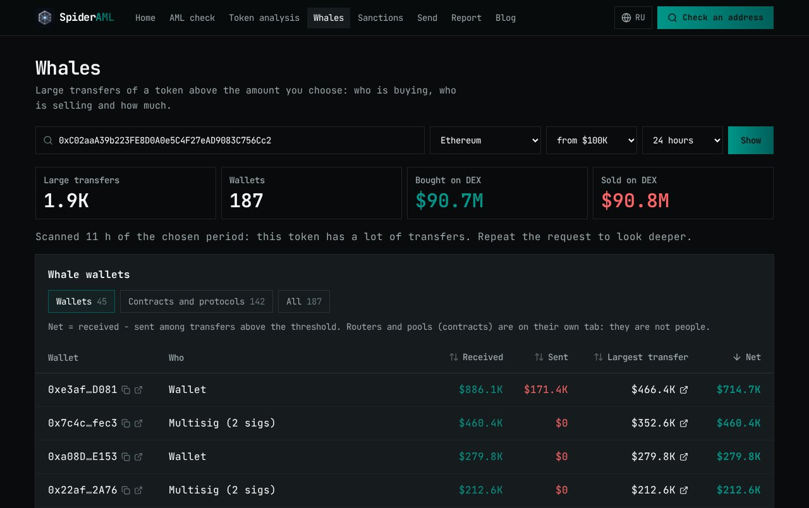

<p align="center">
  
</p>

<h1 align="center">SpiderAML</h1>

<p align="center">
  <b>Check a crypto address before you send money.</b><br>
  Free AML screening of wallets and tokens, explained in plain language, for ordinary people.
</p>

<p align="center">
  <a href="https://spideraml.com"><b>spideraml.com</b></a> ·
  <a href="#how-it-works">How it works</a> ·
  <a href="#strengths-and-limitations">Strengths and limitations</a> ·
  <a href="#smart-contracts">Smart contracts</a>
</p>


## The problem

Crypto use in Kyrgyzstan and Central Asia is growing fast: the regulator reported about **$31 billion** in
virtual-asset turnover in 2025, three times the year before, and around 90% of it goes through local crypto exchangers
rather than exchanges. Losses grow with it:

- **Pyramids.** MCN Coin, an unregistered "investment" token, ended in a fraud case; the organiser publicly admitted it
  was a scam; by early 2025, $1.7 million had been returned to 898 victims.
- **Sanctions exposure.** Western regulators have sanctioned several crypto businesses operating in the region. A person
  who sells USDT on P2P can receive funds from a sanctioned address and have their exchange account frozen.
- **Phishing and drainers.** One signature on a fake site empties a wallet.

Professional AML tools (Chainalysis, TRM, Elliptic, Crystal) are sold to companies under enterprise contracts, in
English, for compliance teams. An ordinary user has nothing but Telegram chats.

## What SpiderAML does

| Tool | Answers the question | What it looks at |
|---|---|---|
| **Address check** (`/check`) | Is it safe to send money to this address? | Official sanctions lists, exploit / phishing / scam databases, live GoPlus check, risky counterparties in recent transactions, on-chain registry record. Contracts also get token risk factors |
| **Token analysis** (`/token`) | Can I trust this token? | Price, market cap, CEX and DEX markets with spread and ±2% depth, DEX liquidity, buy/sell flow, top holders with labels, owner and upgrade rights |
| **Whales** (`/whales`) | Who is buying or dumping right now? | Every transfer above a user-set USD threshold, aggregated per wallet (people and contracts on separate tabs), a link to each wallet's largest transaction, DEX buys and sells, labels |
| **Sanctions** (`/sanctions`) | Which crypto addresses are officially sanctioned? | OFAC, UK and EU entries with owner, programme, designation date and a link to the official record |
| **Safe send** (`/send`) | Can a transfer refuse a sanctioned recipient by itself? | `SpiderSend` contract checks both parties against the on-chain registry before moving USDC |
| **Report** (`/report`) | I was scammed — what now? | Free report form; reports are reviewed by hand, confirmed addresses join the database, the sender sees the status |

Every verdict comes with the reasons, the source of each reason and what to do next. The interface is in Russian and English (a first visit follows the browser language, the switch is in the header).



## How it works

```
Browser ──HTTPS──▶ Site (Next.js, server-rendered) ──private channel──▶ Data layer
                                                                         ├─ sanctions + risk lists (SQLite, refreshed every 6 h)
                                                                         ├─ scoring, token analytics, whale scans
                                                                         ├─ providers: QuickNode RPC, Zerion, CoinGecko, GoPlus
                                                                         └─ writer key ──▶ SpiderRegistry (on-chain)
```

- **Site** (`web/`, this repo). Next.js 16 App Router. Pages are rendered on the server and the browser receives HTML;
  there is no public JSON API. JavaScript in the browser adds forms, sortable tables, the wallet on `/send` and the
  consent-based analytics below.
- **Data layer** (separate private service). Downloads the lists, stores them, computes scores, runs token analytics
  and pushes critical addresses on-chain. Holds all provider keys. The site talks to it over a private channel
  authenticated with a shared secret; the data layer has no public address at all.
- **Contracts** (`contracts/`). A risk registry that other contracts can read and a "send with a check" contract.

### Data sources

| Source | Type | Coverage |
|---|---|---|
| OFAC SDN (US Treasury) | official sanctions | ~1,050 crypto addresses, 20 assets (BTC, ETH, USDT, TRX…) |
| UK Sanctions List (FCDO) | official sanctions | addresses quoted in designations, with designation dates |
| EU Consolidated Financial Sanctions List | official sanctions | addresses quoted in entity remarks |
| ScamSniffer, MyEtherWallet darklist | phishing / drainers | ~3,200 addresses |
| Etherscan-family public labels | exploits, phishing, entity tags | 6 chains, ~32,000 labels |
| Forta labelled datasets | exploits, malicious contracts and deployers | ~15,000 records |
| GoPlus Security | live lookup per request | aggregates SlowMist, BlockSec and others |
| User reports | confirmed by hand | grows with the community |
| CoinGecko, Zerion, QuickNode | market data, wallets, on-chain logs | 7 EVM chains |

In total about **43,000 labelled addresses**, ~12,000 of them risky, ~1,100 from official sanctions lists.
Chains: Ethereum, BNB Chain, Arbitrum, Base, Polygon, Optimism, Avalanche, plus Tron (sanctions and risk databases).

### Methodology

**Address normalisation.** EVM addresses are validated and normalised (EIP-55); Tron addresses are verified with
base58check. Addresses quoted in free-text sanctions documents (UK, EU) are extracted only if their checksum is valid —
EVM, Tron, Bitcoin base58check, bech32 and bech32m — so registration numbers and typos never become "sanctioned
addresses".

**Address score (0–100).** Each finding has a severity: 3 critical (sanctions, exploits, drainers), 2 elevated,
1 low, 0 neutral tag (exchange, protocol).

| Input | Contribution |
|---|---|
| strongest direct finding | severity 3 → 100, 2 → 60, 1 → 25 |
| flagged counterparties in the last 50 transactions | up to 40 (more flagged and critical ones weigh more) |
| token heuristics, if the address is a token contract | 70% of the token risk score |

The final score is the maximum of the three. Levels: **80+ critical**, **50+ high**, **20+ medium**, below 20 low.
Taking the maximum instead of a sum keeps one strong, sourced reason from being diluted and avoids inflating scores
from many weak ones.

**Token risk factors.** Holder concentration excluding pools and burn addresses (30 points), liquidity depth against
market cap (20), source verification (20), upgradeability and owner type (14), market coverage (10). A factor that
cannot be evaluated is listed as "not scored" instead of silently counting as zero.

**Whales and holders.** Holders are discovered from Transfer logs over the last 14 days and confirmed with
`balanceOf`; whale reports scan logs adaptively within a request budget and state how much of the window they
actually covered.

**On-chain sync.** Only critical EVM addresses in the sanctions, exploit and phishing categories go to
`SpiderRegistry`, diffed against what is already there and written in batches of 150, one storage slot per address.

**Ingestion safety.** A source replaces its data only after a successful download; a broken or truncated feed keeps
the previous data (OFAC refuses to import fewer than 100 addresses).

## Strengths and limitations

### Strengths

- **Free and for people.** No account, no wallet, no payment needed to check an address.
- **Explains itself.** A plain-language verdict, every reason with its source and a link, and what to do next.
- **Official sanctions from three regulators** read directly from OFAC, UK and EU publications, not from mirrors.
- **One place for the whole picture:** sanctions, scam databases, counterparties, token structure, CEX/DEX markets
  and whales.
- **Enforcement, not only advice.** `SpiderRegistry` can be read by any contract; `SpiderSend` refuses a critical
  counterparty on-chain.
- **Privacy by design.** No accounts and no IP addresses stored. Own statistics count visitors with an anonymous id
  that changes every day; checked addresses (public blockchain data) are kept only for usage statistics. Google
  Analytics 4 loads only after the visitor accepts a banner and never receives addresses or search text.
- **Small attack surface.** Server-rendered pages, no public API, strict security headers, no wallet SDK dependencies
  (0 known vulnerabilities in production dependencies).

### Limitations

- **Public data only.** If a scam is not yet in any list, SpiderAML will not know about it. A low score is not a
  guarantee of safety.
- **Shallow tracing.** Counterparty analysis looks one hop away, at the last 50 transactions on the selected chain. It
  does not follow funds through mixers or bridges the way commercial forensics does.
- **Heuristics, not an audit.** Token risk factors are signals worth checking, not a verdict on the project or its
  code.
- **Partial coverage.** The holder list is a lower bound (dormant wallets are invisible); CEX data depends on
  CoinGecko; Tron has no transaction analysis yet; OFAC does not publish a per-address listing date.
- **False positives are possible.** Open lists contain mistakes; the report form lets anyone dispute a label, but
  official sanctions entries cannot be changed by us.
- **Early stage.** Contracts run on a testnet and production runs on a single server.
- **Not a standalone open-source app.** The data layer is private, so this repository alone renders the interface but
  has no data behind it.

## Smart contracts

| Contract | Purpose |
|---|---|
| `SpiderRegistry` | `address → (category, level)` in one storage slot. Writers push packed batches; `checkTransfer(from, to)` for integrators; `Ownable2Step` owner manages writers |
| `SpiderSend` | Sends one token with a registry check in front; reverts with `Blocked(account, category, level)` for level 3; never holds funds |
| `examples/SpiderGuardedERC20` | Example ERC-20 that screens every transfer, mint and burn |

Levels: 0 none · 1 low · 2 elevated · 3 critical (blocked). Categories: SANCTIONED, EXPLOIT, PHISHING, SCAM, MIXER, OTHER.

**Arbitrum Sepolia (421614)** — verified on Sourcify:

| Contract | Address |
|---|---|
| SpiderRegistry | [`0xB7E00e6f9bD10E50F17E12847a83E9dCaA0429E2`](https://sepolia.arbiscan.io/address/0xB7E00e6f9bD10E50F17E12847a83E9dCaA0429E2) |
| SpiderSend (Circle test USDC) | [`0xAAd92220c7b1896efDcDc59D73552E7D97A34484`](https://sepolia.arbiscan.io/address/0xAAd92220c7b1896efDcDc59D73552E7D97A34484) |

```bash
cd contracts
forge test                     # 31 unit + fuzz tests
forge coverage --ir-minimum    # 100% of src/ and examples/
```

Deploy and verify: `scripts/deploy.sh <network>` and `scripts/verify.sh <chainId>` (keys in `.env`, see `.env.example`).

## Tech stack

| Part | Stack |
|---|---|
| Site | Next.js 16, React 19, TypeScript, Tailwind CSS 4, shadcn/ui, next-intl, TanStack Query and Table, viem, Recharts, MDX |
| Data layer | Bun, SQLite, viem, Zod |
| Contracts | Solidity 0.8.28, Foundry, OpenZeppelin |
| Hosting | Docker Compose on a VPS behind Cloudflare Tunnel (no inbound ports), Cloudflare Access for the admin panel |
| CI/CD | GitHub Actions: lint, type-check and tests on every pull request; a merge to `main` builds the image and ships it to the server, with an automatic rollback if it is not healthy |

## Repository layout

```
web/           site (Next.js)
.github/       CI and deploy workflows
contracts/     smart contracts and tests (Foundry)
deployments/   deployed contract addresses per chain
scripts/       contract deploy / verify, local run
assets/brand/  logos
docs/          design decisions, roadmap, how to publish blog posts
```

## Running locally

```bash
cd web
npm install
cp .env.example .env.local     # DATA_URL and DATA_SECRET of a running data layer
npm run dev                    # http://localhost:3000
```

Contracts build and test without anything else (`cd contracts && forge test`).

## Roadmap

- Kyrgyz interface
- AML API, address monitoring and alerts for crypto exchangers
- Manual wallet assessments and token / project due diligence as paid services
- Deeper tracing (multi-hop fund flows) and Tron transaction analysis
- More official sources, including the Israeli NBCTF seizure lists
- Registry on more networks; owner moved to a multisig before any mainnet deployment

Details: [`docs/ROADMAP.md`](docs/ROADMAP.md) · design decisions: [`docs/DECISIONS.md`](docs/DECISIONS.md).

## Disclaimer

Scores are produced automatically from public data. They are not legal advice and not an accusation: addresses can be
listed by mistake. Always double-check before acting on a result.

## Contact

Site issues and suggestions: [workzero02@gmail.com](mailto:workzero02@gmail.com) ·
report a scam address: [spideraml.com/report](https://spideraml.com/report)
