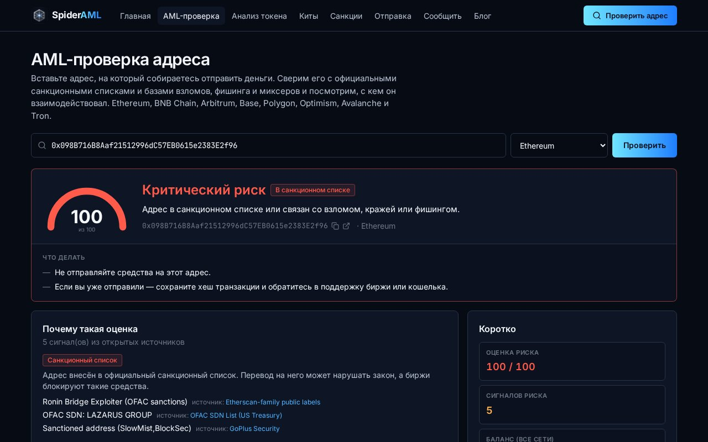
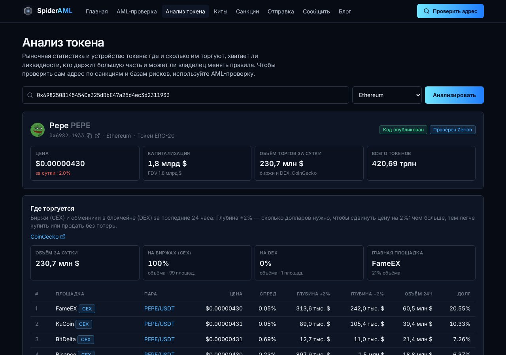

<p align="center">
  
</p>

<h1 align="center">SpiderAML</h1>

<p align="center">
  <b>Проверьте криптоадрес до того, как отправить деньги.</b><br>
  Бесплатная AML-проверка адресов и токенов — понятным языком, для обычных людей.
</p>

<p align="center">
  <a href="https://spideraml.com"><b>spideraml.com</b></a>
</p>

---



## Зачем

Криптовалютой в Кыргызстане и регионе пользуется всё больше людей: обменники, P2P, оплата от зарубежных заказчиков,
вложения в новые токены. Вместе с этим растут потери — пирамиды вроде MCN Coin, фишинг, дрейнеры кошельков, и новый риск:
получить средства с адреса, связанного с санкционной структурой, и потерять доступ к бирже или банку.

Профессиональные AML-инструменты продаются компаниям по дорогим контрактам. SpiderAML даёт ту же базовую проверку любому
человеку: вставил адрес — за секунды получил оценку риска, причины с источниками и совет, что делать.

## Что умеет

| Раздел | Что показывает |
|---|---|
| **AML-проверка адреса** | Оценка риска 0–100 и вердикт: есть ли адрес в официальных санкционных списках, связан ли со взломами, фишингом, миксерами, с какими рискованными адресами взаимодействовал. Для контрактов — риски токена |
| **Анализ токена** | Цена, капитализация, торги на биржах (CEX) и DEX со спредом и глубиной ±2%, ликвидность в пулах, крупные держатели с метками, права владельца контракта |
| **Киты** | Крупные переводы токена дороже заданной суммы: кто покупает, кто продаёт, по каждому кошельку |
| **Санкционные адреса** | Криптоадреса из официальных списков США, Великобритании и ЕС: кому принадлежит, программа, дата включения, ссылка на запись в источнике |
| **Безопасная отправка** | Перевод USDC через смарт-контракт SpiderSend, который сам отказывается отправлять на санкционный адрес или адрес взломщика |
| **Сообщить об адресе** | Пострадавшие сообщают о мошеннических адресах; заявки проверяются вручную и пополняют базу, отправитель видит статус |
| **Блог** | Разборы exit-скамов и пирамид: как распознать заранее |



## Данные

Только открытые и официальные источники, обновление автоматически каждые 6 часов.

- **Санкции:** OFAC SDN (США), UK Sanctions List (Великобритания), EU Consolidated List (ЕС).
- **Взломы, фишинг, мошенничество:** ScamSniffer, MyEtherWallet darklist, публичные метки обозревателей Etherscan
  (6 сетей), датасеты Forta, проверка GoPlus в момент запроса, подтверждённые заявки пользователей.
- **Рынки:** CoinGecko (биржи и DEX), Zerion, данные блокчейна.

Сети: Ethereum, BNB Chain, Arbitrum, Base, Polygon, Optimism, Avalanche и Tron (для Tron — санкции и базы рисков).

> Оценка строится автоматически по открытым данным. Это не юридическое заключение и не обвинение: адреса могут
> попадать в списки по ошибке.

## Смарт-контракты

| Контракт | Назначение |
|---|---|
| `SpiderRegistry` | Реестр рисков в блокчейне: `address → (category, level)`. Другие контракты вызывают `checkTransfer(from, to)` |
| `SpiderSend` | Перевод одного токена с проверкой по реестру; адреса с критическим уровнем (3) блокируются |
| `examples/SpiderGuardedERC20` | Пример токена, который сам проверяет каждый перевод |

Уровни: 0 — нет записи · 1 — низкий · 2 — повышенный · 3 — критический (перевод блокируется).
Категории: SANCTIONED, EXPLOIT, PHISHING, SCAM, MIXER, OTHER.

**Тестовая сеть Arbitrum Sepolia (421614):**

| | Адрес |
|---|---|
| SpiderRegistry | [`0xB7E00e6f9bD10E50F17E12847a83E9dCaA0429E2`](https://sepolia.arbiscan.io/address/0xB7E00e6f9bD10E50F17E12847a83E9dCaA0429E2) |
| SpiderSend (Circle test USDC) | [`0xAAd92220c7b1896efDcDc59D73552E7D97A34484`](https://sepolia.arbiscan.io/address/0xAAd92220c7b1896efDcDc59D73552E7D97A34484) |

Исходники верифицированы через Sourcify. Тесты Foundry (unit + fuzz), покрытие `src/` — 100%:

```bash
cd contracts
forge test
forge coverage --ir-minimum
```

## Как устроено

```
Браузер ──HTTPS──> сайт (Next.js, рендер на сервере) ──закрытый канал──> слой данных (списки, оценка, аналитика)
                                                                              │
                                                       SpiderRegistry <───────┘ критичные адреса
```

- **Сайт** (`web/`) — Next.js 15, страницы рендерятся на сервере, публичного API нет. Браузер получает готовый HTML;
  JavaScript нужен только для кошелька на странице отправки.
- **Слой данных** — отдельный закрытый сервис: собирает списки, считает оценку, хранит ключи провайдеров. Сайт
  обращается к нему по закрытому каналу с секретом.
- **Приватность:** без регистрации и cookies, проверяемые адреса не сохраняются, статистика посещений обезличена.

## Структура репозитория

```
web/           сайт (Next.js 15, TypeScript, Tailwind)
contracts/     смарт-контракты (Foundry)
deployments/   адреса развёрнутых контрактов
scripts/       деплой и верификация контрактов, локальный запуск
assets/brand/  логотипы
docs/          решения, план, как публиковать посты в блог
```

## Локальный запуск

Для работы сайту нужен слой данных (закрытый репозиторий). Контракты можно собрать и протестировать без него.

```bash
cd web && npm install && cp .env.example .env.local   # DATA_URL и DATA_SECRET слоя данных
npm run dev                                           # http://localhost:3000
```

## Документы

- [`docs/DECISIONS.md`](docs/DECISIONS.md) — почему сделано именно так
- [`docs/ROADMAP.md`](docs/ROADMAP.md) — план развития
- [`docs/BLOG.md`](docs/BLOG.md) — как опубликовать статью в блоге

## Контакты

Ошибка на сайте или предложение: [workzero02@gmail.com](mailto:workzero02@gmail.com).
Мошеннический адрес: [spideraml.com/report](https://spideraml.com/report).
