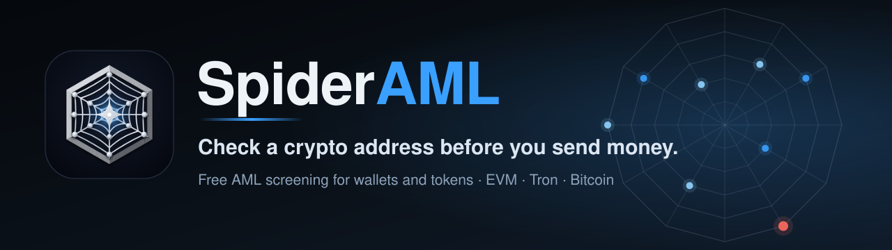
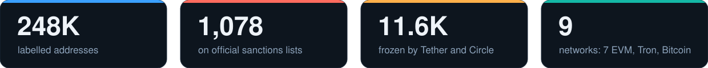
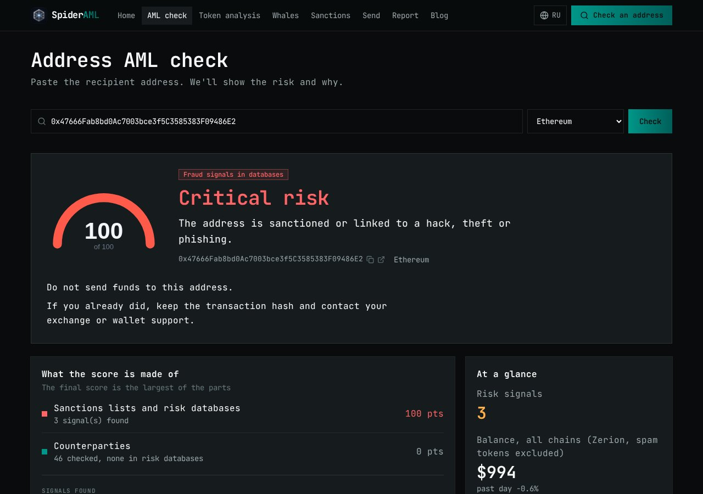
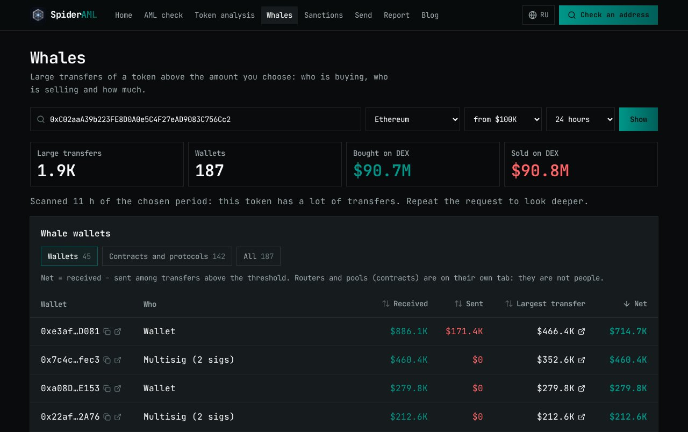
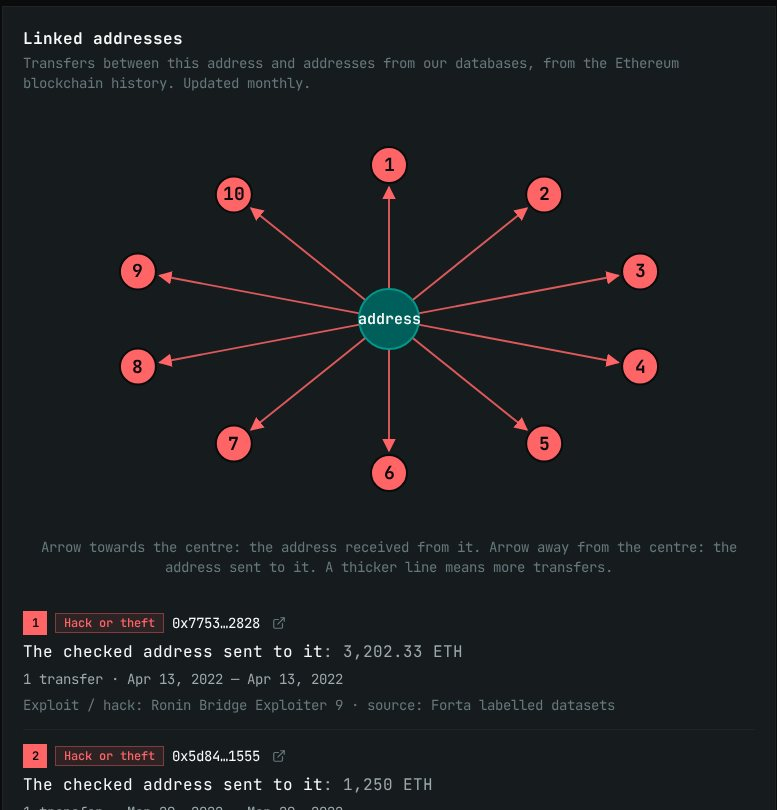
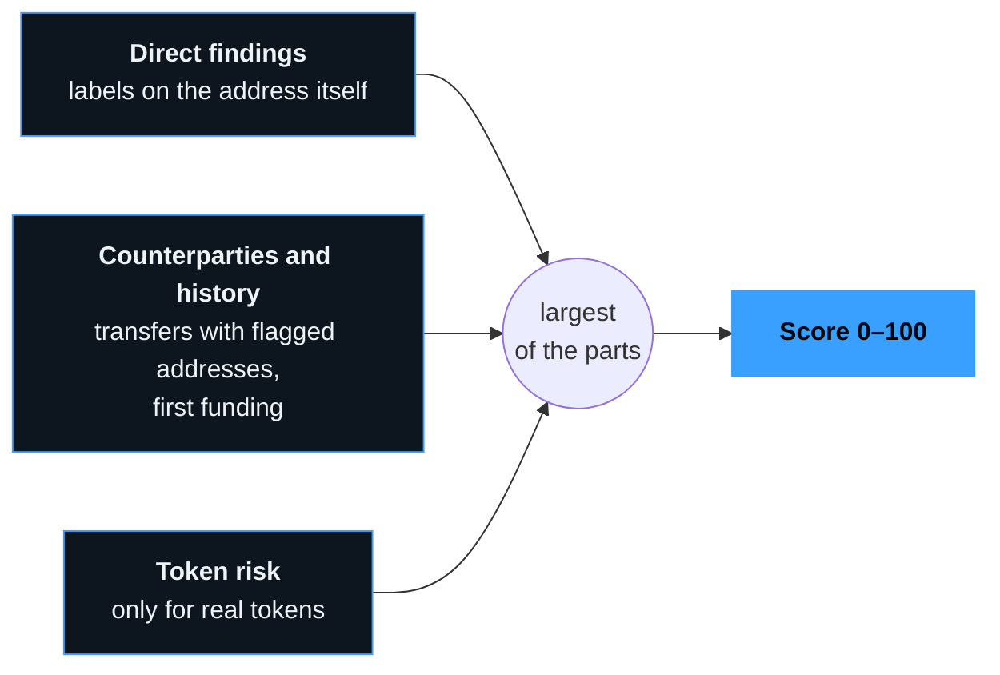
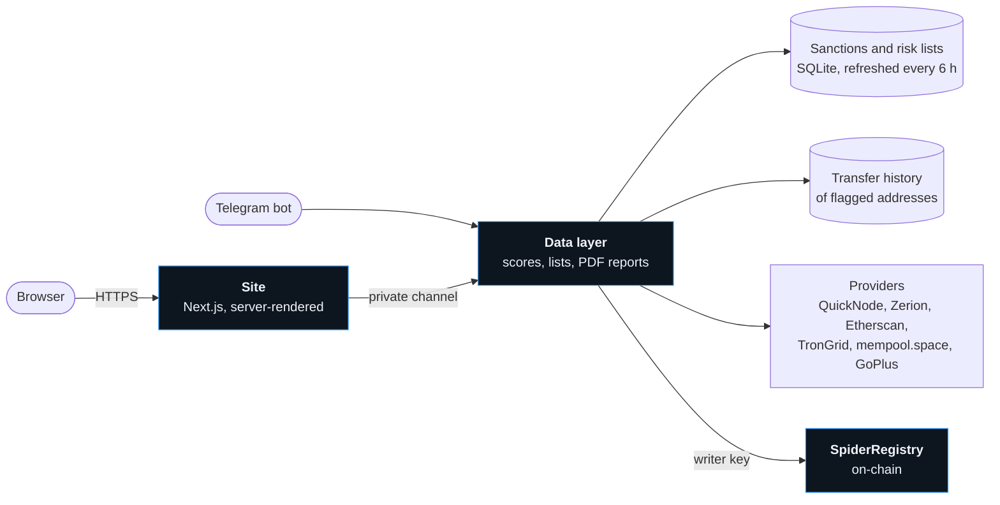

<p align="center">
  
</p>

<p align="center">
  <a href="https://spideraml.com"></a>
  
  
  
</p>

<p align="center">
  <a href="https://spideraml.com"><b>Open the site</b></a> &nbsp;·&nbsp;
  <a href="#what-it-does">What it does</a> &nbsp;·&nbsp;
  <a href="#how-a-score-is-built">How a score is built</a> &nbsp;·&nbsp;
  <a href="#data">Data</a> &nbsp;·&nbsp;
  <a href="#smart-contracts">Contracts</a>
</p>

<p align="center"><b>English</b> &nbsp;|&nbsp; <a href="README.ru.md">Русский</a></p>

<p align="center"></p>

<p align="center"></p>

## Why it exists

Anyone who takes USDT in a P2P deal, buys a token or signs a transaction can lose money to an address that was already known to be bad. Professional AML tools (Chainalysis, TRM, Elliptic, Crystal) are sold to companies under enterprise contracts. An ordinary person has a search box on a block explorer and chats. SpiderAML gives the same kind of check, with its reasons and sources, to a person, for free, in Russian and English.

<table>
<tr>
<td width="50%" valign="top">🏛️ <b>Sanctions exposure</b><br>A wallet that receives funds from a sanctioned address can have its exchange account frozen.</td>
<td width="50%" valign="top">🎣 <b>Phishing and drainers</b><br>One signature on a fake site empties a wallet.</td>
</tr>
<tr>
<td valign="top">☠️ <b>Address poisoning and fake tokens</b><br>A look-alike address, or a token named "USDT" that is worth nothing.</td>
<td valign="top">🪤 <b>Exits and rug pulls</b><br>A token whose owner can take the liquidity or mint without limit.</td>
</tr>
</table>

## What it does

<table>
<tr>
<td width="50%" valign="top">🔎 <b>Address check</b> &nbsp;<a href="https://spideraml.com/check"><code>/check</code></a><br>Is it safe to send money to this address? Sanctions, scam and exploit databases, Tether and Circle freezes, risky counterparties, the history of transfers with flagged addresses, wallet age and first funding.</td>
<td width="50%" valign="top">📄 <b>PDF report</b><br>The same check as a document: every reason with its source, the transfers, the limits of the check. Its ID is derived from its content.</td>
</tr>
<tr>
<td valign="top">🪙 <b>Token analysis</b> &nbsp;<a href="https://spideraml.com/token"><code>/token</code></a><br>Can I trust this token? Markets, liquidity, holders, owner and upgrade rights.</td>
<td valign="top">🐋 <b>Whales</b> &nbsp;<a href="https://spideraml.com/whales"><code>/whales</code></a><br>Who is buying or dumping right now? Transfers above your USD threshold, grouped per wallet.</td>
</tr>
<tr>
<td valign="top">🏛️ <b>Sanctions</b> &nbsp;<a href="https://spideraml.com/sanctions"><code>/sanctions</code></a><br>OFAC, UK and EU entries with a link to the official record and a page for each address.</td>
<td valign="top">🧊 <b>Frozen</b> &nbsp;<a href="https://spideraml.com/frozen"><code>/frozen</code></a><br>Addresses Tether and Circle have blocked, with a link to the freezing transaction.</td>
</tr>
<tr>
<td valign="top">🛡️ <b>Safe send</b> &nbsp;<a href="https://spideraml.com/send"><code>/send</code></a><br>A contract that refuses a sanctioned recipient by itself, checking both parties on-chain.</td>
<td valign="top">📣 <b>Report a scam</b> &nbsp;<a href="https://spideraml.com/report"><code>/report</code></a><br>Free form, reviewed by hand; confirmed addresses join the database and the sender sees the status.</td>
</tr>
<tr>
<td valign="top">💬 <b>Telegram bot</b><br>The same check in a chat: the verdict, the main reasons and the PDF.</td>
<td valign="top">📚 <b>Blog</b> &nbsp;<a href="https://spideraml.com/blog"><code>/blog</code></a><br>How flash USDT and the most common crypto scams work, in plain language.</td>
</tr>
</table>

Every verdict comes with the reasons, the source of each reason and what to do next. The interface is in Russian and English (the first visit follows the browser language; the switch is in the header). An address of a network we do not check (Solana, Litecoin, XRP, TON…) is named as unsupported instead of being called invalid, and the zero and burn addresses are answered as "not a wallet".

<details>
<summary><b>What each tool looks at, in detail</b></summary>

| Tool | What it looks at |
|---|---|
| **Address check** | Official sanctions lists, exploit / phishing / scam databases, addresses frozen by Tether and Circle, a live GoPlus check (its flags are kept in our own database), risky counterparties in recent transactions, the history of transfers with flagged addresses (a diagram), the wallet's age and first funding, the on-chain registry record. Ethereum and compatible chains, Tron and Bitcoin |
| **PDF report** | Summary, every reason with its source, the transfers with flagged addresses, wallet age and first funding, the limits of the check |
| **Token analysis** | Price, market cap, CEX and DEX markets with spread and ±2% depth, DEX liquidity, buy/sell flow, top holders with labels, owner and upgrade rights |
| **Whales** | Every transfer above a user-set USD threshold, aggregated per wallet, a link to each wallet's largest transaction, DEX buys and sells, labels |
| **Sanctions** | OFAC, UK and EU entries with owner, programme, designation date and a link to the official record |
| **Frozen** | Search and filter by network and asset |
| **Safe send** | `SpiderSend` checks both parties against the on-chain registry before moving USDC |

</details>

<table>
<tr>
<td width="50%" valign="top"></td>
<td width="50%" valign="top"></td>
</tr>
<tr>
<td align="center"><sub>Whales: who is moving what, right now</sub></td>
<td align="center"><sub>Linked addresses: who the wallet has dealt with, with the source of each label</sub></td>
</tr>
</table>

## How a score is built

The score is 0–100. It is the **largest** of three parts, not a sum: one strong, sourced reason is not diluted, and many weak ones do not inflate it.



| | Score | Meaning |
|---|---|---|
| 🟢 | **0–19** | Low. Nothing found in our sources. This is never "safe" |
| 🟡 | **20–49** | Medium. Weak signals or a small contact with a flagged address |
| 🟠 | **50–79** | High. A serious label, a freeze, or a large contact |
| 🔴 | **80–100** | Critical. Sanctions, a hack, a drainer, or a huge contact with one |

| Part | What it is | Up to |
|---|---|---|
| **Direct findings** | The strongest label on the address itself. Severity 3 (sanctions, exploits, drainers) → 100, 2 (elevated) → 60, 1 (weak) → 25. A mixer label stays below critical (cap 75) | 100 |
| **Counterparties and history** | The largest of: flagged counterparties in the latest transfers (up to 40); transfers with flagged addresses, where the kind of the other address and the size of the contact decide; the source of the first funding | 95 |
| **Token** | Only if the address is a real token (has decimals and a total supply): 70% of the token risk score | 70 |

**Transfers with flagged addresses, by kind and size** (weak / medium / strong / huge contact): sanctioned 20 / 45 / 65 / 85, theft 15 / 40 / 60 / 80, mixer 20 / 40 / 60 / 75, phishing and scam 10 / 25 / 45 / 55; +2 for each further risky address, 95 at most. Sizes count only real assets (ETH, stablecoins, WBTC, BTC, TRX): thirty spam-token transfers do not make a contact "huge".

<details>
<summary><b>The rules that keep the score honest, address handling, ingestion safety</b></summary>

Rules that keep the score honest:

- **Direction matters.** A scam, phishing or hack address the wallet only *paid* is not a signal (victims pay scammers); sanctions, freezes and mixers count both ways.
- **Dust is not a relationship.** An incoming transfer below the dust limit (1 USD, 3,000 satoshi) does not make its sender a counterparty, and one tiny incoming transfer from a sanctioned or mixer address is context only (address poisoning and dusting attacks can force it on anyone).
- **Services are not suspects.** An exchange, protocol or token with its own label gets nothing from links, and a freeze on an exchange wallet does not make everyone who used the exchange risky.
- **Weak labels stay weak.** Severity 1 comes from a research dataset with no source per address: it is shown, never gives a high score and never makes a counterparty risky.
- **Tornado Cash is a mixer.** Its pools are labelled "sanctioned" by community lists, but the sanctions were lifted in 2025 and the addresses are on no official list: they weigh as a mixer.
- **No label means no verdict, not a clean one.** "Nothing found" always says what was searched.
- **Corrections are possible.** An address the team reviewed and cleared drops the open-database flags; official sanctions cannot be overruled.

**Address handling.** EVM addresses are checked with EIP-55: an all-lower or all-upper case address has no checksum and passes, a mixed-case address with a wrong letter is refused instead of being "corrected" into another wallet. Tron and Bitcoin (legacy, P2SH, bech32, taproot) are verified by checksum. Addresses quoted in free-text sanctions documents are extracted only if their checksum is valid.

**Frozen funds.** Tether and Circle can blacklist an address in their own contracts, empty or not. We read every blacklist and release event, keep the newest one per address (an unfrozen address leaves the list) and show it with severity 2: it is the issuer's decision, not proof of a crime.

**Token risk factors.** Holder concentration excluding pools and burn addresses (30 points), liquidity depth against market cap (20), source verification (20), upgradeability and owner type (14), market coverage (10). A factor that cannot be evaluated is listed as "not scored", never silently counted as zero.

**On-chain sync.** Only critical EVM addresses in the sanctions, exploit and phishing categories go to `SpiderRegistry`, diffed against what is there and written in batches of 150. Before anything is sent the cost is estimated and the sync is refused (unless forced by a person) when it would remove more than 10% of the entries, change over 20,000, pay over 1 gwei per gas or run past the writer's balance; mainnet writes need two explicit switches (`docs/MAINNET.md`).

**Ingestion safety.** A source replaces its data only after a successful download and a format check (a sample must parse as addresses, categories must be valid); a broken or truncated feed keeps the previous data. Official lists are protected from shrinking by more than 30% (the EU list holds 8 addresses, so even a small cut is refused).

</details>

## Data

In production today: about **248,400 labelled addresses** (import of 7 November 2026).

| | Addresses | What the label says |
|---|---|---|
| 🔴 Serious | ~25,100 | Official sanctions, exploits, phishing, issuer freezes. All 1,078 addresses on the official sanctions lists are here, and about 11,600 are blocked by Tether or Circle |
| 🟡 Weak | ~39,200 | A signal from a public research dataset with no source per address: shown, never a high score |
| ⚪ Neutral | ~184,200 | Who the address is (exchange, protocol, token), no risk |

Every label on a check page names its source with a link, and the admin panel shows the date of each dataset (when its publisher last changed it, not when we downloaded it), so an old snapshot cannot pass for fresh data.

<details>
<summary><b>All sources and what each covers</b></summary>

| Source | Type | Coverage |
|---|---|---|
| OFAC SDN (US Treasury) | official sanctions | ~1,050 crypto addresses, 20 assets (BTC, ETH, USDT, TRX…) |
| UK Sanctions List (FCDO) | official sanctions | addresses quoted in designations, with designation dates |
| EU Consolidated Financial Sanctions List | official sanctions | addresses quoted in entity remarks |
| ScamSniffer, MyEtherWallet darklist | phishing / drainers | ~5,300 addresses; the ScamSniffer address list is a snapshot of 28 Feb 2024 |
| Etherscan address labels, two copies | exploits, phishing, entity tags (exchanges, protocols) | `etherscan-labels`: ~32,000 addresses, a snapshot of October 2023; `eth-labels` (MIT, September 2026): ~62,000 more. A check page shows them as "Found in the Etherscan database" with a link to the address there (decision of 2026-11-07, see `docs/DECISIONS.md`) |
| GraphSense TagPacks (MIT, Iknaio Cryptoasset Analytics GmbH) | neutral owner labels: exchanges, mining pools, DeFi protocols, CoinJoin tags | ~75,800 addresses, almost all Bitcoin; reviewed packs only, no risk labels |
| Forta labelled datasets | exploits, malicious contracts and deployers | ~8,100 labels; a snapshot of January 2023 |
| Tether and Circle freezes | addresses the issuers blacklisted in their own contracts (read from the contract events) | USDT on Ethereum and Tron, USDC on Ethereum, Arbitrum, Polygon, Base, Optimism and Avalanche; ~11,600 addresses frozen now |
| MyEtherWallet and Trust Wallet token lists (MIT) | neutral "who is this" labels | ~15,900 addresses; shown in the owner card, never as a warning |
| Ethereum Fraud Dataset (Ishmukhamedov, 2025, CC-BY-4.0) | weak signal | ~51,000 addresses marked as scam in a public research dataset, snapshot of July 2025 |
| GoPlus Security | live lookup per request; the flags it returns are saved as our own labels | aggregates SlowMist, BlockSec and others |
| mempool.space, Blockstream | Bitcoin transactions at the time of the request | the last 25 transactions of a checked address (a second API answers if the first is slow) |
| TronGrid | Tron USDT (TRC20) transfers at the time of the request | the last 50 transfers of a checked Tron address |
| Google BigQuery public Ethereum data | transfer history of flagged addresses, built offline | ~380,000 links for ~10,900 flagged addresses |
| User reports | confirmed by hand | grows with the community |
| CoinGecko, Zerion, QuickNode | market data, wallets, on-chain logs | 7 EVM chains |

</details>


**In progress.** The transfer history is being extended beyond BigQuery with data collected directly: counterparties of flagged addresses from Etherscan, TronGrid and mempool.space, plus Tornado Cash deposits and withdrawals, about 1.06 million unique addresses in total. It is loaded only after a dry run on a copy of the database, with hubs (exchanges and services, thousands of flagged addresses each) kept apart and scored as "unidentified, high-traffic" instead of being dropped, and every load written to a ledger in the admin panel.

## Architecture



- **Site** (`web/`, this repo). Next.js 16 App Router. Pages are rendered on the server and the browser receives HTML; there is no public JSON API. JavaScript in the browser adds forms, sortable tables, the wallet on `/send` and the consent-based analytics.
- **Data layer** (separate private service). Downloads the lists, stores them, computes scores, runs token analytics and pushes critical addresses on-chain. Holds all provider keys. The site talks to it over a private channel authenticated with a shared secret; the data layer has no public address at all.
- **Contracts** (`contracts/`). A risk registry that other contracts can read and a "send with a check" contract.

## Strengths and limitations

<table>
<tr><th width="50%">✅ Strengths</th><th width="50%">⚠️ Limitations</th></tr>
<tr>
<td valign="top">

- **Free and for people.** No account, no wallet, no payment.
- **Explains itself.** A plain-language verdict, every reason with its source, and what to do next.
- **Official sanctions** of three regulators, read from OFAC, UK and EU publications, not from mirrors.
- **Honest about its data.** Every label names its source; weak signals are kept apart from serious ones; a failed provider is reported on the page, not shown as "nothing found".
- **The whole picture:** sanctions, scam databases, counterparties, token structure, markets and whales.
- **Enforcement, not only advice.** `SpiderSend` refuses a critical counterparty on-chain.
- **Privacy by design.** No accounts, no IP addresses stored; an anonymous visitor id that changes daily; Google Analytics only after consent, never with addresses.
- **Small attack surface.** Server-rendered pages, no public API, strict security headers.

</td>
<td valign="top">

- **Public data only.** A scam not yet in any list is unknown to us. A low score is not a guarantee.
- **Shallow tracing.** One hop away; it does not follow funds through mixers or bridges like commercial forensics.
- **Some data is old.** Two label sets are snapshots from 2023.
- **Heuristics, not an audit.** Token factors are signals to check, not a verdict on the project.
- **Partial coverage.** Holder lists are a lower bound; CEX data depends on CoinGecko; networks other than EVM, Tron and Bitcoin are not checked.
- **False positives happen.** Open lists contain mistakes; anyone can dispute a label, but official entries cannot be changed by us.
- **Early stage.** Contracts run on a testnet; production runs on a single server.
- **The data layer is private,** so this repository alone renders the interface with no data behind it (demo data aside).

</td>
</tr>
</table>

## Smart contracts

| Contract | Purpose |
|---|---|
| `SpiderRegistry` | `address → (category, level)` in one storage slot. Writers push packed batches; `checkTransfer(from, to)` for integrators; `Ownable2Step` owner manages writers |
| `SpiderSend` | Sends one token with a registry check in front; reverts with `Blocked(account, category, level)` for level 3; never holds funds |
| `examples/SpiderGuardedERC20` | Example ERC-20 that screens every transfer, mint and burn |

Levels: 0 none · 1 low · 2 elevated · 3 critical (blocked). Categories: SANCTIONED, EXPLOIT, PHISHING, SCAM, MIXER, OTHER.

**Arbitrum Sepolia (421614)**, verified on Sourcify and Arbiscan. The registry holds 9,966 critical addresses (written on 4 November 2026) and `SpiderSend` refuses a transfer to any of them; before mainnet see [`docs/MAINNET.md`](docs/MAINNET.md).

| Contract | Address |
|---|---|
| SpiderRegistry | [`0xB7E00e6f9bD10E50F17E12847a83E9dCaA0429E2`](https://sepolia.arbiscan.io/address/0xB7E00e6f9bD10E50F17E12847a83E9dCaA0429E2) |
| SpiderSend (Circle test USDC) | [`0xAAd92220c7b1896efDcDc59D73552E7D97A34484`](https://sepolia.arbiscan.io/address/0xAAd92220c7b1896efDcDc59D73552E7D97A34484) |

```bash
cd contracts
forge test                     # 31 unit + fuzz tests
forge coverage --ir-minimum    # 100% of src/ and examples/
```

Deploy and verify: `scripts/deploy.sh <network>` and `scripts/verify.sh <chainId>` (keys in `.env`, see `.env.example`).

<details>
<summary><b>Tech stack</b></summary>

| Part | Stack |
|---|---|
| Site | Next.js 16, React 19, TypeScript, Tailwind CSS 4, shadcn/ui, next-intl, TanStack Query and Table, viem, Recharts, MDX |
| Data layer | Bun, SQLite, viem, Zod; Google BigQuery public data for the offline transfer history |
| Contracts | Solidity 0.8.28, Foundry, OpenZeppelin |
| Hosting | Docker Compose on a VPS behind Cloudflare Tunnel (no inbound ports), Cloudflare Access for the admin panel |
| CI/CD | GitHub Actions: lint, type-check and tests on every pull request; a merge to `main` builds the image and ships it to the server, with an automatic rollback if it is not healthy |

</details>

<details>
<summary><b>Repository layout and running locally</b></summary>

```
web/           site (Next.js)
.github/       CI and deploy workflows
contracts/     smart contracts and tests (Foundry)
deployments/   deployed contract addresses per chain
scripts/       contract deploy / verify, local run
assets/brand/  logos
docs/          design decisions, roadmap, ideas, the before-mainnet checklist, how to publish blog posts
```

```bash
cd web
npm install
cp .env.example .env.local     # DATA_URL and DATA_SECRET of a running data layer
npm run dev                    # http://localhost:3000
```

Without `DATA_URL` the site runs on generated demo data, so every page can be opened. Contracts build and test without anything else (`cd contracts && forge test`).

</details>

## Roadmap

- [ ] Load the directly collected transfer history (Ethereum, Tron, Bitcoin) into production after the dry run
- [ ] Kyrgyz interface
- [ ] AML API, address monitoring and alerts for crypto exchangers
- [ ] Manual wallet assessments and token / project due diligence as paid services
- [ ] Deeper tracing (multi-hop fund flows); Bitcoin balance and history from our own node
- [ ] More official sources, including the Israeli NBCTF seizure lists
- [ ] Registry on more networks; owner moved to a multisig before any mainnet deployment

Details: [`docs/ROADMAP.md`](docs/ROADMAP.md) · design decisions: [`docs/DECISIONS.md`](docs/DECISIONS.md).

## Disclaimer

Scores are produced automatically from public data. They are not legal advice and not an accusation: addresses can be listed by mistake. Always double-check before acting on a result.

## Contact

Site issues and suggestions: [workzero02@gmail.com](mailto:workzero02@gmail.com) ·
report a scam address: [spideraml.com/report](https://spideraml.com/report) ·
support the project: [spideraml.com/support](https://spideraml.com/support) ·
[Telegram](https://t.me/spiderAml) · [X](https://x.com/SpiderAml) · [Instagram](https://www.instagram.com/spideraml) · [LinkedIn](https://www.linkedin.com/company/spideraml)
